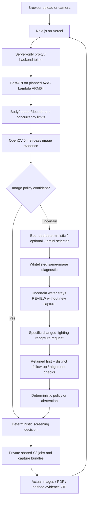

# LoopSight architecture — implemented code and deployment target

The website and inference flow have been tested locally. The AWS deployment
below is prepared in CloudFormation, not yet verified in an account.

Local workers use the same bounded SQLite file. Cloud mode explicitly selects
S3 through `LOOPSIGHT_EVIDENCE_BUCKET`; read/write failures return 503 with no
local fallback. S3 object TTL is enforced on reads; lifecycle deletion is
asynchronous. The optional legacy DynamoDB job adapter surfaces errors and rejects
oversized inline items; it is not the primary deployment path.

The ARM64 container uses pinned Python 3.13 dependencies, the same inference
source as local execution, a revision fingerprint, private encrypted evidence,
scoped IAM, a generated server-only backend token, bounded Lambda concurrency,
seven-day logs and an error alarm. See [deployment guide](../infra/aws/README.md).
The prior `architecture_diagram.svg` depicts a historical design and is not a
verified picture of the current deployment. Use this diagram in the submission.

The image-space measurement contract prohibits physical NTU/mm claims.
Same-image processing and actual second inputs have separate observation
accounting. Policy/source snapshots and file/pixel hashes support review; hashes
do not certify physical identity, capture time, labels or camera authenticity.

The `/evaluation` page reads the committed regression report. It is not populated
from canned verdicts or advertised as an independent physical benchmark. The
`/capture-guide` page supplies a printable contrast target and collection guidance.
