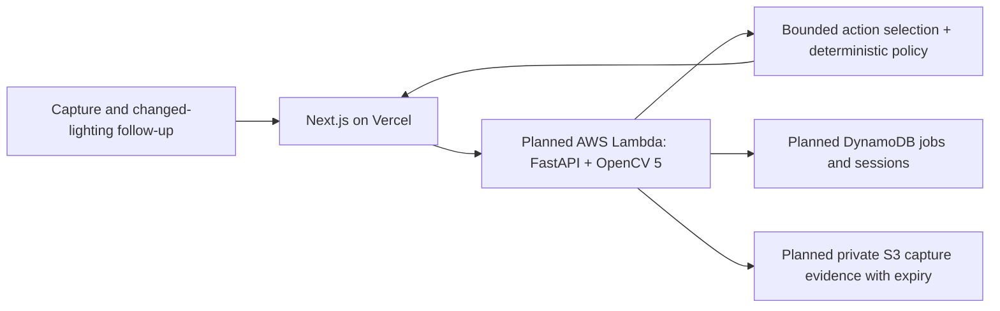

# Proposal status and owner-review draft

Checked 18 October 2026 against the public
[OpenCV overview](https://opencv.org/opencv-ai-competition-2026/).
The owner confirms Devpost registration. Proposal submission remains unverified.
The Devpost challenge/rules pages are blocked by remote protection, and the
owner's profile plus Jotform are blocked by this environment's running network
policy. No account session, private dashboard or form was accessed or submitted.

The overview's participation terms say **“Submit the cloud compute grant
proposal.”** Its Phase 2 description refers to teams that submitted the required
proposal. It also says teams not selected for a grant remain eligible for prizes.
These statements distinguish submitting a proposal from receiving credits.
Registration alone does not establish completion of the proposal requirement.
The governing Devpost rules and organizers must resolve any ambiguity or late
proposal availability; this document cannot confirm eligibility.

The official overview links its proposal buttons to
https://www.jotform.com/form/262145877145059. The owner should check the original
registration/proposal confirmation and private dashboard. If no receipt exists,
ask organizers whether the required proposal was included in registration or
needs separate action. Do not assume a currently accessible form accepts late
entries. No messages to organizers have been sent.

## Draft content for review, not a submitted proposal

**Team/project:** LoopSight. Team member identities and biographies must be
supplied by the owner; they have not been invented here.

**Problem and target users:** People conducting low-cost visual checks may get
unreliable readings when lighting, glare and framing hide a checkerboard behind
a water sample. LoopSight investigates whether specific recapture instructions
can improve relative visibility screening while abstaining on ambiguous inputs.
It does not certify water potability or replace laboratory testing.

**OpenCV 5 analysis:** Checkerboard visibility, contrast, sharpness, glare,
perspective and vertical variation are measured from images. A bounded controller
selects permitted diagnostic processing or requests a new image. Distinct capture
pairs undergo translation/appearance checks; deterministic policy returns PASS,
FAIL, REVIEW or NO_PATTERN_DETECTED. Measurements stay in image units.

**Planned AWS component:** Containerized FastAPI/OpenCV inference on AWS Lambda
ARM64, durable jobs/session metadata in DynamoDB and private expiring capture
objects in S3. This is the intended deployment: the current code retains capture
sessions in SQLite for local workers, and shared AWS capture storage is not yet
implemented or verified. Vercel hosts the Next.js web interface and proxies to
inference. Account permissions, real runtime measurements and cloud costs must
be established before claiming an operational AWS system.

**Evaluation/demonstration:** First verify transport, retained first-pass evidence,
duplicate/unrelated-pair rejection, missing-target abstention and worker restart.
Then collect independent grouped physical captures and compare single, fixed,
exact-budget matched and adaptive acquisition on a frozen blind test. Report
coverage, false clears, rejected pairs, requested inputs, latency and cost. The
existing generated fixtures are regression evidence only and currently show a
tie among strategies that use the six available follow-ups.

**Award path:** Agentic Vision is the intended fit: visual uncertainty changes
the next action and requests human recapture. Optional Gemini selects tools;
the deterministic controller is explicit. COOL has not been integrated, so no
COOL qualification or award claim is made.

**Team biography:** Owner to complete with actual members, roles and experience.
