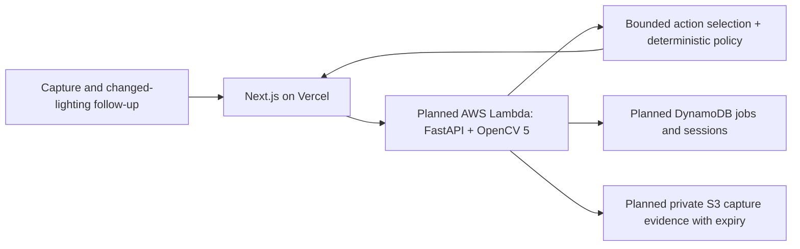

# Grant proposal clarification and archived optional draft

Corrected 18 October 2026 after successfully reading the current Devpost Rules,
overview, official grant announcement and linked grant form.

**A grant proposal is not required to remain eligible for prizes.** The
[official linked form](https://www.jotform.com/form/262145877145059) says:

> Submissions for AWS Grants are closed. All teams, even those who were not
> selected or did not submit a proposal, are still eligible for all prizes!

The earlier instruction to verify a proposal receipt as a prerequisite was wrong
and is withdrawn. The general OpenCV page contains conflicting proposal wording;
the linked form explicitly resolves the no-proposal case. The
[official announcement](https://opencv26.devpost.com/updates/46417-aws-compute-grant-notifications-have-been-sent)
also confirms the same prizes and judging rubric for teams without a grant.

See [the complete rules recheck](COMPETITION_RULES_RECHECK.md) for the actual
submission checklist, deadline discrepancy, optional award paths and other
published inconsistencies. The October 7–14 dates on Devpost apply to grant
recipient check-ins. They are not the final submission deadline. The exact date
when the grant form closed was not established.

Registration is owner-confirmed. No private dashboard was accessed and no form
was submitted. No late grant application is needed for the build path.

## Archived optional grant draft — not required and not submitted

**Team/project:** LoopSight. Team member identities and biographies must be
supplied by the owner; they have not been invented here.

**Problem and target users:** People conducting low-cost visual checks may get
unreliable readings when lighting, glare and framing hide a checkerboard behind
a water sample. LoopSight investigates whether specific recapture instructions
can improve relative visibility screening while abstaining on ambiguous inputs.
It does not certify water potability or replace laboratory testing.

**OpenCV 5 analysis:** Checkerboard visibility, contrast, sharpness, glare,
perspective and vertical variation are measured from images. A bounded controller
selects permitted diagnostic processing or requests a new image. Distinct capture
pairs undergo translation/appearance checks; deterministic policy returns PASS,
FAIL, REVIEW or NO_PATTERN_DETECTED. Measurements stay in image units.

**Planned AWS component:** Containerized FastAPI/OpenCV inference on AWS Lambda
ARM64, durable jobs/session metadata in DynamoDB and private expiring capture
objects in S3. This is the intended deployment: the current code retains capture
sessions in SQLite for local workers, and shared AWS capture storage is not yet
implemented or verified. Vercel hosts the Next.js web interface and proxies to
inference. Account permissions, real runtime measurements and cloud costs must
be established before claiming an operational AWS system.

**Evaluation/demonstration:** First verify transport, retained first-pass evidence,
duplicate/unrelated-pair rejection, missing-target abstention and worker restart.
Then collect independent grouped physical captures and compare single, fixed,
exact-budget matched and adaptive acquisition on a frozen blind test. Report
coverage, false clears, rejected pairs, requested inputs, latency and cost. The
existing generated fixtures are regression evidence only and currently show a
tie among strategies that use the six available follow-ups.

**Award path:** Agentic Vision is the intended fit: visual uncertainty changes
the next action and requests human recapture. Optional Gemini selects tools;
the deterministic controller is explicit. COOL has not been integrated, so no
COOL qualification or award claim is made.

**Team biography:** Owner to complete with actual members, roles and experience.
